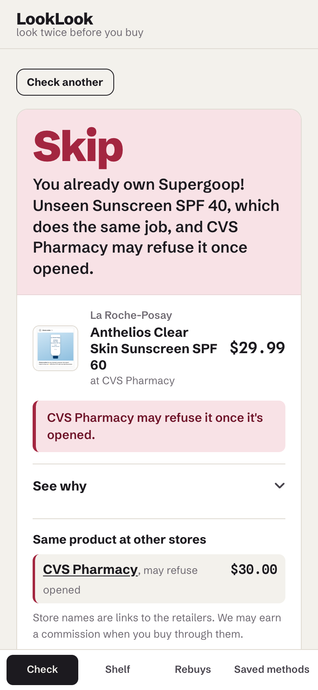
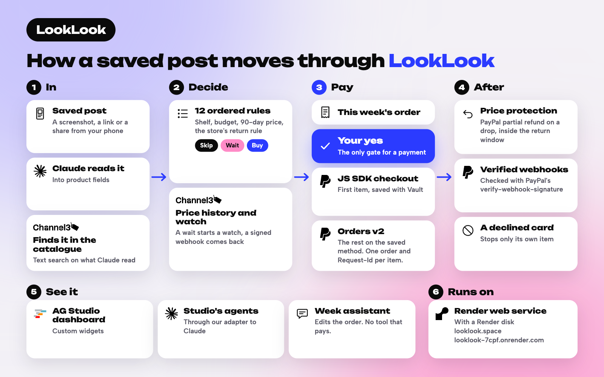

# LookLook

*look twice before you buy*

Stop buying what you already own. Pay for the rest with one PayPal yes.

**Try it:** [looklook.space](https://looklook.space) (also at [looklook-7cpf.onrender.com](https://looklook-7cpf.onrender.com)). Start with the five-step tour: [looklook.space/judge](https://looklook.space/judge).

[](lib/facts/facts.test.ts)
[](lib/facts/facts.test.ts)
[](lib/facts/facts.test.ts)
[](lib/facts/facts.test.ts)
[](lib/facts/facts.test.ts)
[](lib/facts/facts.test.ts)

**Checks.** Each badge states a number that `lib/facts/facts.test.ts` recomputes from the committed data and code, so a stale badge fails `npm test`. Every other number and capability this README, `/proof`, `/judge` and the app state is listed in [FACTS.md](FACTS.md) with the test or outside source that checks it.

For anyone who buys skincare and makeup they saw on their feed and ends up with a second of something they already own: LookLook checks the post against your shelf, your budget, the price history and the store's return policy before you pay.



**On 30 products it had never seen, LookLook's skip was right 28 times. Skipping anything in a category you own gets 19, and saying skip to everything gets 13.** Skip precision 92.3% (12 of 13 skips right), recall 92.3% (12 of 13 caught). Of the 12 right skips, 10 rest on evidence (the shelf, or a cited store policy) and 2 on our default that an unknown opened-return policy counts as not returnable. The order of work is in git: the engine last changed in `4fbf420` (2026-11-06 22:28 EST), the 30 expected answers were committed in `effe79b` (2026-11-07 00:17 EST), and the one scored run was committed as generated in `e3cd601` (2026-11-07 00:20 EST). The wrong skip, the missed skip and the five other misses are in [`eval/holdout/RESULTS.md`](eval/holdout/RESULTS.md) and on the app's `/proof` page; `GET /api/eval/holdout` returns every case, read from that run's committed results.

The same model with no LookLook rules got it right 27 times (median of 3 runs, range 27 to 27). It was asked in plain words whether to skip each product; how it was run, and where it and LookLook each went wrong, is in [`eval/baseline/RESULTS.md`](eval/baseline/RESULTS.md).

The 65 products the matching was developed on come second, because they were used to improve it: 58 of 65 there (same category gets 40; saying skip to everything gets 39). Its first scored run was 55 of 65 and one similarity change later 60 of 65; then a store policy we had misread was corrected, together with the expected answers it affected, and it is 58 of 65 ([`eval/skip-set/RESULTS.md`](eval/skip-set/RESULTS.md); see Corrections below). `GET /api/eval/skip` and `npm run eval:skip` re-run it with no network calls.

Spending limits decide how much an AI shopping agent may spend; LookLook decides whether to buy at all. Price timing is the second question; the first is whether you already own one. And you're charged only after your yes, every time; the only money that moves on its own is money coming back to you. When it's a staple, PayPal Vault makes buying it again one yes.

Before you buy what you saw on your feed, LookLook checks it, and its most common answer is skip. Send it a screenshot of a creator post or a store link. It reads the product, finds it in the catalogue, and checks it against what you already own, this month's budget, the 90-day price history and whether the store takes it back once opened. Then it says **skip**, **wait**, **buy** or asks you to confirm, with the one-line reason and the evidence behind it, and lists the same product at other stores with what each store does with opened items. A wait says what it is waiting for: next month's budget (with a reminder), a lower price (with a price watch, the 90-day trend and the target), or the one you own running low.

The things you do buy again (a cleanser, a moisturizer) come back as one-tap reorders: when a staple nears its run-out date or a watched price drops, LookLook asks you first, and only your yes charges the payment method you saved with PayPal.

## How it works



## Try it

Open `/judge` on the running app for five short steps. Sandbox PayPal buyer login and test card: see the testing instructions on the project's submission page.

1. **Hand it your week.** The week page (`/week`) takes a sample shopper's week of saved posts at once: a sunscreen and a vitamin C serum she already owns one of (skips, with the money kept), a retinol to wait on (its price watch starts with the yes) and a peptide serum to buy, plus a cleanser on her shelf that's running out. This week's order lists each item with its price. The first item goes through PayPal checkout with the save box; after that, one yes pays the rest with the saved card or PayPal account.
2. **Open the sunscreen skip.** On the Check page (`/check`), the sunscreen post is a skip because she owns one that does the same job; See why shows the rule, the shelf item and the store's return policy. Four sample posts (mock posts of real products) are there too, or upload your own screenshot or paste a store link.
3. **Reorder with one yes, then a decline.** Staples due within five days ask for your yes, and a repeated yes charges once. A switch on the Reorders page makes the next reorder answer `INSTRUMENT_DECLINED`; LookLook then asks you to pay with another card or PayPal account.
4. **See your decisions in AG Studio.** The dashboard shows verdicts, reorders, shelf and budgets in one AG Studio workspace; a reorder is paid from inside it, and Group my waits has Studio's agents build a table of what each wait is waiting for.
5. **See the webhooks and the accuracy test.** `/events` lists the latest 100 webhooks and whether each was verified; `/proof` leads with the result on products the app had never seen and lists every miss, then re-runs the 65-product development set the matching was built on.

One yes on this week's order pays each item at the price shown, each as its own PayPal payment. If a price in the order moved, nothing is charged and the order is shown again. A declined item doesn't stop the others, and saying yes again never charges a paid item twice. After the yes, each item bought gets price protection for as long as its store takes it back opened (from the cited return policies): if that store lowers its price in that time, the difference comes back to the card and to the month's budget, so next week's order is built on it. The finished week has a labelled sandbox test price drop that makes a real sandbox refund. The price watch starts before the first payment on purpose: buying the peptide serum spends this month's skincare budget, and the retinol would then wait for next month's budget instead of a lower price.

From a phone, share a store link, a post or a screenshot straight to LookLook: the "Look twice" Shortcut on iPhone (one tap to add, from `/share` in the app), or the installed app in Android's share sheet. A link that isn't a store page is read from the picture it shows. How to set it up: `/share`, or [docs/share-shortcut.md](docs/share-shortcut.md) (tested on desktop).

## Built with

The first column is the built-with tag, sponsors first. Paths are from the repo root. Routes are on the running app.

| Built-with tag | Product or feature | What it does here | Where in the code | Where to see it |
|---|---|---|---|---|
| PayPal, PayPal JS SDK | PayPal JS SDK (Buttons and Card Fields, v6 at `?sdk=v6`) | The shopper approves the first purchase with the PayPal wallet or a card. The same checkout also runs on JS SDK v6 (one-time payment session and Card Fields, saving the method during the purchase). | `app/components/CheckoutPanel.tsx`, `app/components/CheckoutPanelV6.tsx`, `lib/paypal/sdk-v6.ts`, `app/checkout/[id]/page.tsx` | `/week`, then the first item's checkout (`/checkout/<id>`, or `/checkout/<id>?sdk=v6`) |
| PayPal Agent Toolkit | PayPal Agent Toolkit (`get_order`, `get_refund`) | The Studio week assistant reads what PayPal recorded for a paid item. Read-only: no tool creates, pays or refunds. | `lib/paypal/toolkit.ts`, `app/api/week/[id]/paypal/route.ts`, `lib/studio/slip.ts` | `/studio/week`, after paying: ask "Did PayPal take the payment for the serum?" |
| PayPal Orders API | PayPal Orders v2 | Creates and captures every payment; success is read from the capture status, because a declined card can still return a completed order. | `lib/paypal/orders.ts`, `app/api/checkout/order/route.ts`, `app/api/checkout/capture/route.ts` | `/week`, each receipt (`/receipts/<id>`) |
| PayPal Vault | PayPal Vault v3 (save during purchase) | Saves the wallet or card for later under a short customer id, only when the shopper ticks the save box. | `lib/paypal/vault.ts`, `lib/paypal/orders.ts` | The save box at the first checkout, then `/payments` |
| PayPal Orders API, PayPal Vault | Customer-initiated charges on a saved method | Each reorder is the shopper's yes on an approval card (`payment_initiator: CUSTOMER`, `usage: SUBSEQUENT`), capped per reorder. One yes on this week's order pays each item the same way. | `lib/paypal/rebuy.ts`, `lib/app/pay.ts`, `lib/app/week.ts`, `app/api/week/[id]/approve/route.ts` | `/week` (one yes), `/rebuys` (Reorders) |
| PayPal Orders API | `PayPal-Request-Id` idempotency | One id per shopper, item and cycle, and saved method, so a repeated yes, or a price drop and a run-out date for the same item, charge once. | `lib/paypal/idempotency.ts`, `lib/app/single-flight.ts` | `/week`: tap yes twice, one charge |
| PayPal Vault | Payment token delete | Payments page: remove a method and confirm PayPal no longer has it. | `lib/paypal/vault.ts`, `lib/app/methods.ts`, `app/api/methods/[id]/route.ts` | `/payments` |
| PayPal | Refunds | A charge can be refunded in full from its receipt. After the yes, LookLook keeps looking: Inside the store's own window for returning an opened item, a lower price at that store gets you the difference: the sandbox test store refunds it to your card, and it goes back into that month's budget, once for each lower price. A Channel3 subscription scoped to that store reports the prices, and each refund is a partial refund on the payment's capture, credited back to the month's budget. Where no such window is on record, or the store doesn't take the item back opened, there is no price protection; a price at another store, below half of what you paid, a price rise, or a drop after the window never refunds anything. Only refunds happen without your yes. A price event never charges anything. | `lib/paypal/refunds.ts`, `lib/app/guard.ts`, `app/api/receipts/[id]/refund/route.ts` | `/receipts/<id>`, and "Try a price drop" on the finished week (`/week`) |
| PayPal Webhooks | Webhooks + verify-webhook-signature | `/api/webhooks/paypal` verifies every delivery with PayPal, handles a repeated event id once, and confirms receipts and removed methods. | `lib/paypal/webhooks.ts`, `app/api/webhooks/paypal/route.ts`, `lib/app/paypal-events.ts` | `/events` |
| PayPal | Negative testing | Behind `DEMO_NEGATIVE_TESTING=1`: the labelled switch that makes the next reorder decline. | `lib/paypal/client.ts` (`PayPal-Mock-Response`), `lib/app/pay.ts` | `/rebuys` (Reorders) |
| AG Studio | AG Studio (custom widgets, theme, agent framework) | Hosts `/studio`, the dashboard: our verdict widget pays a due reorder on the saved method from inside it and updates the shelf grid in place, and our agent asks Studio's lead agent to build the table of what each wait is waiting for. `/studio/week` puts this week's order in Studio: ask in words ("Leave the cleanser for next week") and the order and its grid change. In the Studio week, the assistant can take an item off this week's order or put it back, but it has no tool that pays: only your yes on the order you see pays. Every change gives the order a new fingerprint, so a yes given for the old order charges nothing. | `app/studio/Workspace.tsx`, `app/studio/widgets.tsx`, `app/studio/WeekWorkspace.tsx`, `app/studio/slip-widget.tsx`, `app/studio/adapter.ts`, `lib/studio/` | `/studio`, `/studio/week` |
| AG Grid | AG Grid, inside AG Studio | The dashboard's grid tables (Price watches, and the table of waits that Group my waits builds) are AG Studio grid widgets, drawn by AG Grid, which comes with `ag-studio`. LookLook doesn't import AG Grid on its own. | `app/studio/Workspace.tsx` (`type: "grid"`), `app/studio/waits.ts` | `/studio`, then Group my waits |
| Channel3 | Channel3 search, image search and URL lookup | Finds the catalogue product behind a screenshot (text search on what Claude read, plus `/v1/image-search` with auto-crop on the picture, which only settles a match the name left unsure) or a pasted link. | `lib/channel3/api.ts`, `lib/channel3/client.ts`, `lib/app/services.ts`, `lib/vision/match.ts`, `lib/app/checks.ts` | `/check` |
| Channel3 | Channel3 product detail and offers | The same product at other stores on a verdict, each joined with that store's opened-return policy; only the store, price and link are kept (cached for a day, never committed). | `lib/app/offers.ts`, `lib/channel3/dedupe.ts`, `lib/channel3/cache.ts` | A verdict (`/check/<id>`) |
| Channel3 | Channel3 price history | 90-day history, filtered to one size and steady points, gives the usual price, the low, the price to wait for and the weekly trend line. | `lib/channel3/clean.ts`, `lib/channel3/band.ts`, `app/components/PriceHistory.tsx` | A verdict (`/check/<id>`) |
| Channel3 | Channel3 product subscriptions + webhooks | A wait verdict starts a price-drop subscription; `/api/webhooks/channel3` checks the signature, handles a repeated event once, and turns a drop to the target into an approval card. A watch counts only price changes at the store you saw, and stopping it never stops another shopper's watch on the same product. | `lib/app/watch-start.ts`, `lib/app/watch.ts`, `lib/app/subscriptions.ts`, `lib/channel3/webhooks.ts`, `app/api/webhooks/channel3/route.ts` | `/events`, `/rebuys` (Reorders) |
| Channel3 | Channel3 buy links | The product link on a verdict, with the commission notice next to it. | `lib/app/offers.ts`, `app/check/[id]/page.tsx` | A verdict (`/check/<id>`) |
| Render | Render web service and disk | One web service runs the app, the API and both webhook endpoints (`render.yaml`), with its data on a 1 GB Render disk. | `render.yaml` | https://looklook-7cpf.onrender.com, `/api/health` |
| Claude, Anthropic, Claude Sonnet 5.5 | Claude (`claude-sonnet-5-5`) through the Anthropic API | Reads a screenshot or a listing into structured fields (strict JSON schema), words the one-line reason after the verdict is decided, and runs the dashboard's agents through our `/api/llm`. Calls go through the Anthropic TypeScript SDK (`@anthropic-ai/sdk`). | `lib/vision/read.ts`, `lib/vision/schema.ts`, `lib/verdict/reason.ts`, `lib/studio/llm.ts`, `app/api/llm/route.ts`, `lib/app/services.ts` | `/check` (upload a screenshot), `/studio` (the assistant) |

The app itself is a Next.js and TypeScript web app on Node.js 22.

Also in the live app: LookLook also sends an uploaded screenshot to Channel3's image search. A confident match by name is kept. When the name isn't enough, the image can find the product, and you still confirm anything below the bar. Through PayPal's Agent Toolkit, the Studio week assistant can read what PayPal recorded for an item it paid (get_order, get_refund). It has no tool that creates, pays or refunds. The checkout also runs on PayPal's JS SDK v6 at ?sdk=v6, saving the method during the purchase the same way.

## How a verdict is decided

The model observes; code decides. Claude turns the screenshot into fields (brand, name, price, store, key attributes); a catalogue match is scored in code, and a weak or tied match asks you to confirm. Twelve ordered rules then decide from structured fields only: shelf similarity, run-out dates, the store's cited return-once-opened policy, the budget left and the cleaned price band. Anything unresolved lands on ask or wait, never buy: an unconfirmed product or a missing price asks, missing price history waits (unless something you use runs out within three days), and a store whose opened-return policy we couldn't find counts as not returnable. Money moves only after your tap, on a method you saved, under the cap you set.

Most big beauty stores take opened beauty back (Sephora, Ulta, Target, Kohl's and CVS do; Walgreens leaves it to the manager), so the return line is usually reassurance ("Ulta Beauty takes opened beauty back within 30 days, so trying it is low risk"; "CVS Pharmacy takes opened beauty back with a receipt") and a reason to skip only where the cited policy refuses opened items or no policy was found.

## Run it

Node 22 or later.

```bash
npm install
cp .env.example .env   # sandbox PayPal keys, Channel3 key, Anthropic key
npm run dev            # or: npm run build && npm start
```

Each browser gets its own session (a cookie) with the sample shelf. Sessions, the webhook event log and caches are written under `.data/` (`APP_DATA_DIR`).

Or run your own copy on Render:

[](https://render.com/deploy?repo=https://github.com/Zen-cronic/looklook)

The button creates the web service and its disk from `render.yaml` (Starter plan, needed for the disk). Render asks for the values it can't fill: `PAYPAL_CLIENT_ID`, `PAYPAL_CLIENT_SECRET` (sandbox keys), `CHANNEL3_API_KEY`, `ANTHROPIC_API_KEY`, `NEXT_PUBLIC_AG_STUDIO_LICENSE_KEY` and `SESSION_SECRET`, plus `PAYPAL_WEBHOOK_ID` and `CHANNEL3_WEBHOOK_SECRET`, which come from the two webhooks you register after the first deploy (see Deploy below).

## Run the checks

```bash
npm run eval:skip        # skip correctness on the development set (no network)
npm run eval:holdout -- --what "what changed"   # re-run the held-out set after an engine change; its scored run is never overwritten
npm test                 # unit tests, including lib/facts/facts.test.ts (every number in this README)
npm run lint
npm run typecheck
npm run build

npm run replay               # wait-timing replay from the local cache; its output stays local (gitignored)
PAYPAL_SMOKE=1 DEMO_NEGATIVE_TESTING=1 npm run smoke:paypal   # live sandbox run of the payment library
CHANNEL3_SMOKE=1 npm run smoke:channel3                       # live product-data run
VISION_SMOKE=1 npm run smoke:vision -- screenshot.png          # live screenshot to verdict
```

## Real and sandbox

- Real: the product catalogue, prices, 90-day price histories and price alerts (Channel3), the screenshot and listing reading (Claude), and the store return policies, each with its source page and the date checked.
- Sandbox: every PayPal payment. Money goes to a PayPal sandbox merchant account presented as "LookLook Test Store"; no real money moves.
- In the sandbox LookLook is also the seller, so it refunds a price difference itself; with a real store the same signal would file that store's price-adjustment request. The "Try a price drop" button on the week and receipt pages sends a simulated price event in Channel3's shape; the refund it makes is a real sandbox refund.
- Simulated, and labelled in the app: the date control on Reorders, the test price drop, the forced decline, and the sample week (a fictional shopper's week of checks on real catalogue products, loaded from `/judge` or the dashboard; Reset puts back a fresh shelf).

## What we'll tell you before you find it

- **Limits.** Sessions are issued by the server in a signed cookie, and the assistant and screenshot checks have per-session and server-wide hourly limits. When one is reached the app says to try again later. A yes is charged at the price you approved; if the price moved, nothing is charged and LookLook asks again.
- **Who sells what.** Checkout and reorders inside LookLook are sold by "LookLook Test Store", a PayPal sandbox merchant, not by the retailer in the post; the store names on a verdict are links to the retailers, and we may earn a commission when you buy through them.
- **PayPal webhook rows appear only once deployed.** PayPal and Channel3 deliver webhooks to a public URL registered with them, so on a local run `/events` shows only the labelled test price drops ("Test event from this app"). A payment's receipt is read from PayPal's capture response either way; the webhook adds a confirmation.
- **PayPal activity import is off.** Filling the shelf from PayPal activity needs the Transaction Search permission on the PayPal app, which this sandbox app doesn't have yet (403). The shelf comes from manual adds and purchases made in the app.
- **Store return rules are short summaries.** Every store's rule in `data/return-policies.json` carries its source page and the date it was checked; a store outside the table has no rule and counts as not returnable once opened. Where a store's page states no time limit (CVS beauty), the app shows none. Sephora's rule (opened beauty back in "new or gently used" condition within 30 days) is read from Sephora's returns page.
- Both skip sets' shoppers, shelves, budgets and expected answers are made up by one person. On the held-out set the wrong skip is a body sunscreen read as overlapping a face sunscreen, the missed skip a matte setting spray when a dewy one is owned, and three products (a conditioner, a hair oil, a kettle) got "ask" because the app had no such category at the time. On the development set seven of 65 skip decisions disagree; the causes are listed in `eval/skip-set/RESULTS.md`. 29 of the 65 cases are at stores outside the policy table, where an unknown policy counts as not returnable; 7 of the 33 right skips depend on that default.
- **After the held-out run, the matching changed once.** The held-out misses showed real gaps, so the app gained conditioner, hair oil or serum, lip balm, kettle and toaster categories, and a sunscreen's area (face, body, or both) became its product type, so a body sunscreen no longer counts as a second face sunscreen (commit `c0d3b0d`, 2026-11-07 00:34 EST). Re-run on that code, the held-out set scores 29 of 30 (same category 18, now that the shopper's lip balm and hair oil stay on her shelf; saying skip to everything 13), but those products shaped the change, so it is no longer a held-out number and the headline stays 28 of 30. The development set stayed at 60 of 65 through that change; the store-policy correction below then took it to 58. Both re-runs are in the "After later changes" sections of the two RESULTS.md files and on `/proof`.
- The first scored run was 55 of 65. Since then the similarity rule changed once (product type, actives, finish and form compared with half credit for neighbouring values; see `eval/skip-set/provenance.json`), and the expected answers were corrected once, for a misread store policy (next point). A first version of that change scored 58 of 65 before its actives rule was replaced; both runs are recorded in `eval/skip-set/README.md`.
- **Corrections.** On 2026-11-07 we found two store policies read from the wrong place. The policy table said CVS may refuse opened beauty, citing CVS's general returns PDF; the beauty section of CVS's return policy page takes beauty back opened or unopened with a receipt or invoice. It also said Target takes opened electronics back for exchange only, but Target's exchange-only list doesn't include electronics. The table was fixed first (commit `a37226a`, 2026-11-07 00:41 EST), then the expected answers at those stores, before any re-run (`e2c06ee`, 00:42 EST): c02, c06, c24, c26 and held-out h09 stay skip without the non-returnable reason, and c61 keeps its verdict with a corrected why. The development set went from 60 to 58 of 65: c06 and c26 overlap only partly with what the shopper owns, and at a store that takes opened beauty back the engine leaves a partial overlap to the price rules. The held-out headline stays 28 of 30, read from the scored run in `e3cd601`: h09 was a near-duplicate skip decided on the shelf, so its verdict and the score are unaffected; only its reason text changed. Details in both RESULTS.md files and on `/proof`. On 2026-11-08 a fresh reading of the stores' own pages corrected three return rules: CVS's beauty section states no time limit (the 60 days we showed is its rule for new, unopened items), Kohl's returns page gives Sephora at Kohl's 30 days (we had changed it to 60 on 2026-11-07 in `5c09f47`, from a single store's page), and Sephora's and Kohl's rules now cite the stores' returns pages. The table changed in `250e1c4` (2026-11-08 15:05 EST). No verdict rule reads a return window, so neither set moved: 58 of 65 on the development set and 29 of 30 on the held-out re-run, with no expected answer changed.
- Dates: receipts, notices, refunds, restocks and event times are real, in US Eastern time. The Reorders date control moves only run-out dates, look-again dates and this month's budgets; while it is ahead, every page that uses it says "Simulated date" and dates counted from it carry "(simulated date)". A bought verdict keeps the reason it had when it was decided, shown as "At the time: …" under a Bought state.
- The four sample posts are mock creator posts we drew; the products and prices in them are real.
- **Filming mode.** The demo video is recorded with `?film=1` (or `NEXT_PUBLIC_FILM_MODE=1`), which shows product, brand and store names generically ("Peptide Serum", "Pharmacy"), unbranded product images, card networks as "Card" and PayPal ids by their last three characters. It is display only: verdicts, prices, return rules and payments are worked out from the real records, and the one outside effect is the item name on the PayPal order. It is off unless asked for; `?film=0` turns it off. The names are in `lib/filming/neutral.ts`.
- Two sandbox behaviours we design around: two simultaneous order requests with the same `PayPal-Request-Id` created two orders (sequential repeats return the first), so same-key payment calls are merged in the app before they reach PayPal; and a payment token deleted seconds after it was saved came back a few seconds later, so removal repeats the delete until two checks find nothing. Both are handled inside one process: run a single instance.
- PayPal's sandbox Orders API rejects a `PayPal-Request-Id` of about 70 characters or more with a bare 422, so longer ids are hashed to at most 64.
- The app keeps its data in files on a 1 GB Render disk (`APP_DATA_DIR=/var/data`), so sessions, saved payment methods and the event log survive deploys and restarts. A new browser starts with a fresh session: load the sample week from `/judge` (one tap) and the rest of the steps work as written.
- Price bands follow each catalogue listing's headline offer, not a single seller.

## Deploy

`render.yaml` describes one Render web service: `npm ci && npm run build`, then `npm start` on `$PORT`, health check `/api/health`, auto-deploy off, on the Starter plan with a 1 GB disk mounted at `/var/data` for app data. Secrets are entered in the Render dashboard, including `SESSION_SECRET` (any long random string; it signs the session cookie). The limits (`LLM_CALLS_PER_HOUR`, `LLM_MAX_TOKENS`, `CHECKS_PER_SESSION_PER_HOUR`, `CHECKS_PER_HOUR`) have defaults in `render.yaml` and `.env.example`. After the first deploy, register `https://<service>.onrender.com/api/webhooks/paypal` in the PayPal app (copy its webhook ID to `PAYPAL_WEBHOOK_ID`) and `https://<service>.onrender.com/api/webhooks/channel3` in the Channel3 dashboard (copy its signing secret to `CHANNEL3_WEBHOOK_SECRET`).

## Licence

MIT
